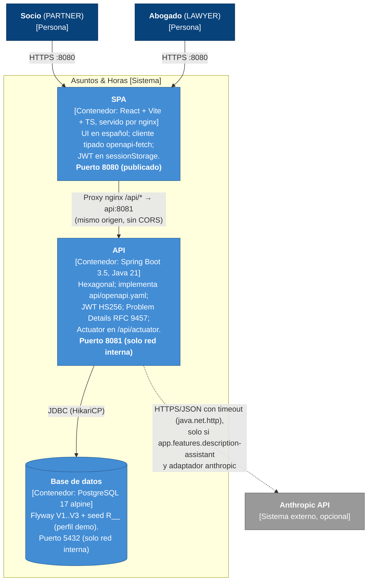

# C4 nivel 2 — Contenedores

Contenedores desplegables de "Asuntos & Horas" tal como los levanta `docker compose` (y `docker-compose.demo.yml` desde GHCR).

## Contenedores

| Contenedor     | Tecnología                       | Puerto                     | Responsabilidad                                                                   |
| -------------- | -------------------------------- | -------------------------- | --------------------------------------------------------------------------------- |
| SPA (frontend) | React + Vite + TypeScript, nginx | **8080** publicado al host | Sirve estáticos y hace proxy de `/api` al backend. Único punto de entrada.        |
| API (backend)  | Spring Boot 3.5.x, Java 21       | **8081** interno           | Casos de uso, reglas de negocio, autenticación y autorización, contrato OpenAPI.  |
| Base de datos  | `postgres:17-alpine`             | 5432 interno               | Persistencia; misma imagen que Testcontainers. Horas en décimas (`hours_tenths`). |

## Notas

- **Mismo origen:** el navegador solo habla con nginx en `:8080`; `/api/*` se reenvía a `api:8081`. No se configura CORS.
- **Healthchecks en cadena:** db (`pg_isready`) → api (`/api/actuator/health`) → spa. `compose up --wait` los usa en E2E y CI.
- **Imágenes:** `ghcr.io/gcastillo-emba/demo-ci-cd-backend` y `-frontend` (ADR-003).
- **Secretos:** `APP_JWT_SECRET` por variable de entorno; default de desarrollo solo en compose (ADR-006).
- **Asistente de descripción:** el flag se expone en `GET /api/features`; con el flag apagado la UI oculta la funcionalidad.
- Contexto: [c4-contexto.md](c4-contexto.md).
