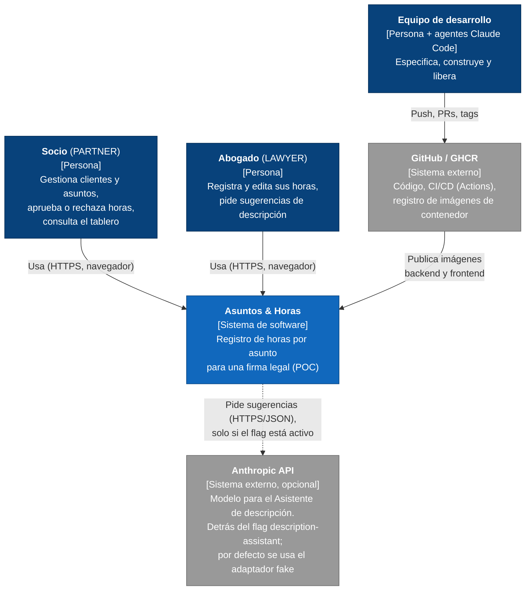

# C4 nivel 1 — Contexto del sistema

Vista de quién usa "Asuntos & Horas" y con qué sistemas externos se relaciona. Datos 100 % sintéticos (ADR-005).

## Notas

- **Actores:** dos roles de negocio (Socio y Abogado). No hay acceso anónimo salvo el login.
- **Anthropic API** es opcional: sin `ANTHROPIC_API_KEY` (bitácora #2) el sistema funciona completo con el adaptador `fake` determinista. Nunca se envía PII; la entrada se limita a 1–500 caracteres.
- **GitHub/GHCR** no es dependencia en tiempo de ejecución: provee las imágenes que `docker-compose.demo.yml` descarga.
- Detalle interno: [c4-contenedores.md](c4-contenedores.md). Decisiones: [ADR-001](../adr/ADR-001-arquitectura-hexagonal-y-api-first.md), [ADR-003](../adr/ADR-003-ci-cd.md), [ADR-006](../adr/ADR-006-autenticacion-jwt.md).
